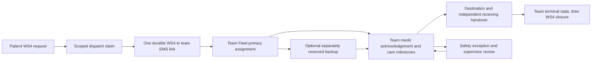

# Workstream 4 branch review and Testing handoff

**Prepared:** 11 October 2026. **Review target:** `feature/jandre-ws4-emergency-dashboard` at `70d44f6` against fetched `origin/Testing` at `c6b29a1`. The feature branch was clean when this document was prepared and was 18 commits ahead of that Testing ref. Re-fetch both refs before review or merge; these hashes are a dated baseline.

**Decision requested from the reviewer:** review the branch and its database upgrade against the exact Testing project, then approve a normal merge only when the schema and rollout plan below are compatible. This document does not assert that the SQL is installed, that Testing contains synthetic-only data, or that a real emergency response has been accepted. Do not enable the team handoff flag merely because the Flutter build passes.

## What this branch delivers

The patient deliberately submits an emergency request. A scoped dispatcher claims it, records priority, notes, callback outcome and patient messages, then creates one linked Fleet/Paramedic incident. Team Fleet assigns one eligible primary crew and, when requested, one separately reserved backup. The assigned medic acknowledges and records clinical milestones. Transport requires confirmed patient matching and a selected active receiving facility. A different, mapped receiving user confirms handover. The team incident reaches a valid terminal state before dispatch closes the patient-facing WS4 case. Exceptions, missed acknowledgements, failed handovers and cancellation have explicit review/recovery paths. A direct phone call remains available; opening the dialler never means a call connected. There is **no ER24 API integration** in this branch.

WS4 `public.incidents.id` and team `public.corvia_ws6_incidents_actual.incident_id` are different bigint IDs; `ws4_private.ems_handoff_links` is the only bridge. WS4 organisation UUID and team hospital UUID are mapped explicitly in `ws4_private.ems_handoff_routes`. Team unit, crew, shift, member, assignment and receiving-facility IDs stay in team tables. Never copy a WS4 resource ID into a team table or assign the same response through both systems. For a routed organisation, team WS5/WS6 owns allocation and clinical progression; WS4 owns request, dispatch claim, patient/dispatch communication and final patient-visible status. The older WS4 private response workflow remains for an unlinked route and must not run in parallel with a linked team response.

The patient status vocabulary remains `pending`, `in_progress`, `resolved`, `cancelled`. The team clinical sequence is `Dispatched` → `Accepted` → `En Route` → `On Scene` → `Transporting` → `At Hospital` → `Handed Over` → `Closed`; team `dispatch_state` also distinguishes escalation/cancellation. UI profile roles are navigation hints; server memberships, route, active assignment, verified member/shift, receiver mapping and authenticated JWT determine authority.

## Retained changes, from first WS4 work to current implementation

| Commit(s) | Change still present in the branch |
| --- | --- |
| `a3480c3`, `9e774f6` | Dispatch queue lifecycle and exact typed JWT/access denial handling. Denial clears retained incident details and stale asynchronous responses cannot restore them. |
| `972ac1a`, `87930b6` | Eugene baselines merged while keeping WS4 queue/access safeguards and app integration. The merge history matters; review the final diff rather than replaying old conflicts. |
| `a0591fb` | Isolated backend configuration, visible emergency phone fallback and safety separation from unverified provider/ER24 operation. |
| `8ccb20d` | Authoritative server-backed dispatch access context, scoped entry, and reconciliation of uncertain claims instead of treating a lost response as a new claim. |
| `5288519` | Deliberate patient intake with optional recorded location/address/details, operation identity and recovery; dispatcher sees the saved details. |
| `2637490` | Pending cancellation, accepted-request cancellation review, genuine persisted history and patient-safe visibility. |
| `c474952` | Versioned dispatch operations, scoped notes/priority/messages/closure, private audit and the guarded shared-backend upgrade candidate. |
| `66aa318`, `3e7738b` | New-pending queue arrival alert and accurate read/arrival state without pretending every queue refresh is a new incident. |
| `5f9f905` | Standalone WS4 unit/crew response workflow for an unlinked route: independent readiness, exclusive reservation, offer/acknowledgement, milestones, location, exceptions and independent handover. It is retained as a separate path. |
| `854f545`, `604b431` | Current Testing Fleet/Paramedic baseline merged into the feature branch; WS4 navigation and access adapted while preserving the team's producer code. |
| `e1a1752` | Additive `002` bridge creates one team EMS case via the team's command, stores an idempotent link and prevents parallel WS4 assignment or premature closure. |
| `c73ecb4` | Additive `003` blocks contradictory provider simulation and makes team-confirmed cancellation appear as `cancelled` to the patient; ordinary linked closure still requires completed team response. |
| `1c54fae` | Additive `004` permits one separately acknowledged backup, unit exclusivity and release; receiving confirmation requires a distinct, owner-mapped person, not the treating medic. |
| `70d44f6` | Additive `005` and UI complete linked-case deadlines/overdue audit, backup messaging and explicit reads, observed callback outcome, real team location/directory view, exception review, patient/destination/failed-handover guards, safe release/readiness expiry, typed denials and same-operation recovery. |

The feature diff includes configuration, CI, tests and documentation as well as WS4 code. It does **not** replace the team's `11_install_fleet_paramedic.sql` or `13_dispatch_fleet_upgrade.sql`. See the exhaustive 122-file inventory at the end; it is generated from `git diff --name-only origin/Testing...70d44f6` and excludes this new document.

## Current WS5/WS6 contract and reviewer focus

The merged team implementation lives primarily in `supabase/scripts/workstreams/11_install_fleet_paramedic.sql` and `13_dispatch_fleet_upgrade.sql`, with `lib/pages/paramedic/*`, `lib/services/paramedic_workspace_service.dart` and the Fleet entry UI. Team `corvia_ems_open`/`corvia_ems_command` and `corvia_ops_*` are the authoritative command/eligibility path. Its records include `corvia_ws6_incidents_actual`, `corvia_ws6_incident_assignments_actual`, `corvia_ws6_units_actual`, crews, shifts, EMS members, patients, handovers and receiving facilities. WS4 calls or guards those team contracts; it does not fabricate a second team assignment.

Review these boundaries carefully: the dispatcher must have both active WS4 organisation membership and team hospital operations membership; a primary medic must be in the active assigned crew; backup membership grants backup controls only, even if that person also has a controller role; the receiver must have an active mapping for the selected facility and cannot self-confirm; team cancellation/no-patient outcomes must map to a real WS4 `cancelled` state; and deactivated/released units need a fresh readiness review. Fleet directory data is not proof of a free bed, accepted patient, verified licence or real-time vehicle position. The map shows recorded coordinates and freshness, not a live moving vehicle or ETA.

The 8 October `RESPONSE_WORKFLOW.md` describes the earlier standalone WS4 path and contains historical statements about then-unavailable WS5/WS6 code. For a **linked** case, this document and the actual `002`–`005` SQL plus team source are the current contract. Do not import older WS4 standalone UUID resource assumptions into team bigint IDs.

## Does the Testing database need changing?

**Yes, if the intended Testing backend does not already contain the reviewed WS4 and team objects.** The repository contains required SQL; it cannot prove which scripts are installed on the actual hosted project, which policies/functions have drifted, or whether it contains real data. Pushing/merging Flutter code does not itself install these SQL scripts: the checked-in Gitea workflow analyzes, tests and builds, and has no database migration step. An owner must inspect the target and run the compatible upgrade. Never apply the fresh `ws4_dev/001_secure_core.sql` bootstrap to the shared Testing database.

| Order | Owner action on the exact target | What it establishes |
| --- | --- | --- |
| 0 | Take/verify a backup and restore route; run read-only `supabase/scripts/ws4_release/preflight.sql`, inspect current catalog, applied objects, triggers/RLS/grants, invalid legacy incident rows and owner/function definitions. Compare the actual team schema too. Stop on drift; scripts intentionally refuse known incompatibilities or reapplication. | The specific backend is safe to upgrade. The repo alone cannot establish this. |
| 1 | If not already present and compatible, review the generated `001_shared_upgrade.sql` under owner control. It is built from `tools/build_ws4_shared_upgrade.py`; include its required explicit review setting in the same SQL-editor request as documented in `ws4_release/README.md`. Do not run it on an already extended WS4 development schema. | Secure WS4 `ws4_private` core: organisation scope, patient intake, claim, versions, messages, history, dispatch operations and standalone response contracts. |
| 2 | Ensure the team's `11_install_fleet_paramedic.sql`, then `13_dispatch_fleet_upgrade.sql`, are present in the required version/order. Their owners review any current differences; do not rerun blindly. | Authoritative Fleet/Paramedic incident, unit, crew, readiness, assignment, clinical and receiving contracts. |
| 3 | Review/install `002_team_ems_handoff.sql`, then `003_team_ems_completion.sql`, then `004_team_backup_receiver.sql`, then `005_team_operational_completion.sql` **once each**, only if absent and compatible. Each is additive WS4 SQL, not a replacement of team source. | Linked case, closure, backup/receiver, and final operational guards/RPCs. An enabled `70d44f6` build requires all of them. |
| 4 | Provision actual organisation-to-hospital route rows, WS4 memberships/patient routes, team operations memberships, verified synthetic crew/shift/readiness records, and `ems_receivers` mappings. Keep route/receiver mappings inactive until identities and existing assignments are reviewed. Use the target's actual Auth UUIDs and team facility IDs. | A narrow permitted demo population; no script guesses identities or activates all hospitals. |
| 5 | If an approved `pg_cron` installation exists, review optional `005_team_deadline_schedule.sql`; otherwise arrange an owner-operated, service-authority call to `corvia_ws4_team_deadline_scan()` each minute. Inspect existing jobs before scheduling. | Durable, idempotent overdue audit alerts. The UI can still calculate overdue timestamps without a worker, but autonomous audit alerts require it. |
| 6 | Only after database and accounts pass smoke checks, enable both `CORVIA_EMERGENCY_DISPATCH_ENABLED=true` and `CORVIA_WS4_TEAM_EMS_HANDOFF_ENABLED=true` in the Testing build with its HTTPS origin and **public** Supabase client key. Keep the team flag false if 002–005 or route mappings are not ready. | The intended linked UI instead of a partial or contradictory workflow. |

The public RPCs are scoped, versioned/idempotent where they mutate state, and private tables have RLS enabled with direct client privileges revoked. A reviewer should still inspect `SECURITY DEFINER` ownership, function execute grants, legacy policies, trigger order, and the current Supabase/PostgREST exposure on the **real target**. Do not embed a service-role key in Flutter. A database-owner installation and a normal-authenticated-user test are different checks.

## Manual Testing acceptance matrix

Use synthetic identities in separate browser profiles/devices: patient, owner dispatcher, competing dispatcher, same-organisation supervisor, unrelated organisation, eligible primary medic, eligible backup medic and separately mapped receiving user. Record account ID, WS4 incident ID, team incident ID, operation ID, screenshots/logs and observed database audit/receipt rows for each case. Do not call a real emergency number as a test.

| Flow | Expected result |
| --- | --- |
| Startup signed out, slow startup and offline cached app | Emergency direct-call choice remains visible; no request or call begins automatically. A browser that has never cached the app cannot first-load offline. |
| Patient request with/without GPS | One request per operation; location source/time/accuracy or explicit unknown; patient sees only their case. |
| Two dispatchers claim together | Exactly one owner and one claim event; loser reconciles state. Revoked/wrong-organisation users get no protected details. |
| Priority, note, patient message, callback | Versioned genuine audit; patient never sees internal note/team detail; recorded callback outcome is based on operator observation, never dialler launch. |
| Handoff and lost response | Exactly one linked team incident; retrying the **same** operation returns the same receipt; changing the operation cannot create a parallel case. |
| Parallel-response guard | A linked route cannot allocate through legacy WS4 response or also produce an accepted/unknown demo-provider response. |
| Fleet assignment | Only ready, eligible, available unit/current crew can be assigned; competing assignments cannot reserve the same unit/crew. Scene/unit positions show source and stale/unknown state. |
| Primary acknowledgement deadline | Before deadline it works; after deadline it is denied, visibly overdue and independently released/escalated. Repeat worker scan produces no duplicate audit alert. |
| Backup request and offer | One separate eligible backup remains reserved alongside primary; wrong user cannot acknowledge; late acknowledgement denied; release requires reason and fresh readiness review. |
| Backup communication | Both authorized sides save/read messages; “read” appears only after explicit other-party action; unrelated user denied; identical retry does not duplicate. |
| Patient and destination guard | Cannot transport without every active patient's match confirmation and an active selected team receiving facility; directory does not claim capacity/acceptance. Test multiple patients too. |
| Failed handover/reroute | Record exception, select a different active facility, deny confirmation of the old attempt, obtain independent supervisor resolution and correct per-patient receiving confirmation. |
| Other exceptions | No-resource, unsafe scene, unit failure, backup-required, multiple patients and refusal block unsafe progression until the documented independent review. Same reporter cannot self-resolve. |
| No patient/refusal terminal path | Supervisor closes without fabricated patient/handover records after required review and resource release; patient-facing WS4 status is `cancelled`. |
| Normal handover/closure | Treating medic cannot confirm their own receipt; mapped receiving user can; premature WS4 closure fails; completed team case then permits one WS4 closure and exact retry. |
| Security and resilience | Cross-organisation, inactive, wrong crew, wrong receiver and revoked users denied; account switch clears retained data; failed reads block actions; lost command response keeps exact operation/payload until resolved. |
| Manual device pass | Test narrow phone UI, browser, Android call intent/location/map/QR permissions and flaky network. Do not label the feature operationally ready from desktop widget tests alone. |

Stop and investigate if actual Testing SQL differs from the expected contracts, RLS exposes clinical/dispatch details to a patient, an uncertain command duplicates a side effect, a team case has a second WS4 resource assignment, a receiving user can self-confirm, or closure bypasses an active resource/exception. Keep the build flag off until these are resolved.

## Evidence and open review gates

On 11 October, local commit `70d44f6` passed the isolated combined PostgreSQL suite (**145 checks**, disposable server stopped), **796 Flutter tests**, changed-file Flutter analysis and an enabled release web build. The final staged diff passed `git diff --check`. Full-repo analysis reported 12 existing findings in untouched admin/doctor files. Web compilation completed with existing `flutter_tts` WebAssembly dry-run warnings; that is not a WASM acceptance test. The Gitea CI result, Android build, hosted schema, Supabase Auth/PostgREST behavior and multi-device workflow were **not** verified by these local results. Reviewer should confirm current CI status and run the target-backend matrix above.

For local reproduction: `flutter test --no-pub`; `flutter analyze --no-pub`; `flutter build web --release --no-pub` with a synthetic local backend profile and both WS4 flags enabled; and `py -3 test/backend/ws4/run_team_ems_bridge_tests.py --pg-bin <PostgreSQL-15-bin>`. The SQL runner creates its own loopback-only disposable cluster and never connects to Testing. To check the generated 001 source without rewriting it, compare `tools.build_ws4_shared_upgrade.build()` with the checked-in SQL byte-for-byte. CI currently builds Flutter but does not run the isolated SQL suite.

Reviewer should return: (1) code/security findings with file and line, (2) compatibility verdict for the exact Testing catalog and installed-script markers, (3) CI/build result, (4) whether synthetic accounts/routes/receivers are ready, and (5) the manual-test record. Until those are available, the precise status is **code implemented and locally verified; Testing integration and deployment unverified**.

## Exact files changed relative to the fetched Testing baseline

The following inventory is the retained feature-branch diff against `origin/Testing` at `c6b29a1`. Configuration/build files support deliberate backend selection and CI; `lib/auth`, `lib/pages`, `lib/services`, controllers, models and widgets implement patient/dispatch/team UX and contracts; `ws4_dev` is the isolated development path; `ws4_release` is the owner-reviewed existing-backend upgrade candidate; `test` and `tool(s)` provide verification and generated SQL. This inventory deliberately names every file even when its individual purpose is explained by its directory and the sections above. The new handoff document itself is additional to the 122-file baseline diff.

<!-- Retained-file inventory generated from git diff --name-only origin/Testing...70d44f6. -->
- .env.example
- .gitea/workflows/ci.yaml
- Dockerfile
- README.md
- compose.yaml
- lib/auth/dispatch_entry_redirect.dart
- lib/auth/fleet_entry_redirect.dart
- lib/auth/login.dart
- lib/config/backend_environment.dart
- lib/config/env.dart
- lib/controllers/dispatch/call_countdown.dart
- lib/controllers/patient_emergency_intake_controller.dart
- lib/main.dart
- lib/models/dispatch/dispatch_access_context.dart
- lib/models/dispatch/dispatch_emergency.dart
- lib/models/dispatch/incident_history.dart
- lib/models/dispatch/patient_emergency_intake.dart
- lib/pages/dispatch/dispatch_dashboard.dart
- lib/pages/dispatch/response_workspace_page.dart
- lib/pages/dispatch/ws4_team_completion_page.dart
- lib/pages/dispatch/ws4_team_operations_page.dart
- lib/pages/forms/corvia_forms_navigator.dart
- lib/pages/hospital/hospital_admin_shell.dart
- lib/pages/paramedic/paramedic_forms.dart
- lib/pages/paramedic/paramedic_incident_page.dart
- lib/pages/paramedic/paramedic_workspace_page.dart
- lib/pages/patient/dashboard.dart
- lib/pages/patient/dispatch.dart
- lib/pages/patient/emergency.dart
- lib/pages/patient/emergency_intake_page.dart
- lib/pages/patient/emergency_phone_page.dart
- lib/pages/patient/profile.dart
- lib/pages/patient/widgets/fleet_management_page.dart
- lib/pages/patient/widgets/fleet_vehicle_card.dart
- lib/pages/patient/widgets/fleet_vehicle_detail_sheet.dart
- lib/pages/shared/settings.dart
- lib/services/corvia_ai_router_service.dart
- lib/services/dispatch/fleet_availability_contract.dart
- lib/services/dispatch_call_controller.dart
- lib/services/emergency_dispatch_service.dart
- lib/services/incident_history_service.dart
- lib/services/incident_workspace_service.dart
- lib/services/paramedic_workspace_service.dart
- lib/services/patient_emergency_intake_service.dart
- lib/services/patient_incident_service.dart
- lib/services/response_workflow_service.dart
- lib/services/ws4_ems_handoff_service.dart
- lib/services/ws4_team_completion_service.dart
- lib/widgets/corvia_startup.dart
- lib/widgets/emergency_phone_card.dart
- lib/widgets/incident_history_panel.dart
- lib/widgets/incident_location_panel.dart
- lib/widgets/incident_workspace_panel.dart
- pubspec.yaml
- supabase/scripts/ws4_dev/001_secure_core.sql
- supabase/scripts/ws4_dev/002_patient_intake.sql
- supabase/scripts/ws4_dev/003_cancel_and_history.sql
- supabase/scripts/ws4_dev/004_dispatch_operations.sql
- supabase/scripts/ws4_dev/005_response_workflow.sql
- supabase/scripts/ws4_dev/CANCEL_AND_HISTORY.md
- supabase/scripts/ws4_dev/HOSTED_API_TESTS.md
- supabase/scripts/ws4_dev/PATIENT_INTAKE.md
- supabase/scripts/ws4_dev/README.md
- supabase/scripts/ws4_dev/verify_core.sql
- supabase/scripts/ws4_emergency_phone_fallback.md
- supabase/scripts/ws4_local_setup.md
- supabase/scripts/ws4_release/001_shared_upgrade.sql
- supabase/scripts/ws4_release/002_team_ems_handoff.sql
- supabase/scripts/ws4_release/003_team_ems_completion.sql
- supabase/scripts/ws4_release/004_team_backup_receiver.sql
- supabase/scripts/ws4_release/005_team_deadline_schedule.sql
- supabase/scripts/ws4_release/005_team_operational_completion.sql
- supabase/scripts/ws4_release/PROVIDER_CONTRACT.md
- supabase/scripts/ws4_release/README.md
- supabase/scripts/ws4_release/RESPONSE_WORKFLOW.md
- supabase/scripts/ws4_release/preflight.sql
- test/backend/ws4/README.md
- test/backend/ws4/baseline/catalog.sql
- test/backend/ws4/baseline/fixtures.sql
- test/backend/ws4/baseline/provenance.json
- test/backend/ws4/build_baseline.py
- test/backend/ws4/run_cancel_and_history_tests.py
- test/backend/ws4/run_dispatch_operations_tests.py
- test/backend/ws4/run_hosted_api_tests.py
- test/backend/ws4/run_hosted_provision_tests.py
- test/backend/ws4/run_patient_intake_tests.py
- test/backend/ws4/run_response_workflow_tests.py
- test/backend/ws4/run_secure_dev_tests.py
- test/backend/ws4/run_shared_upgrade_tests.py
- test/backend/ws4/run_team_ems_bridge_tests.py
- test/backend/ws4/run_tests.py
- test/backend/ws4/test_hosted_api_runner.py
- test/batch10_emergency_page_test.dart
- test/dispatch_dashboard_test.dart
- test/emergency_dispatch_dashboard_test.dart
- test/emergency_dispatch_lifecycle_test.dart
- test/emergency_page_test.dart
- test/emergency_phone_card_test.dart
- test/emergency_phone_page_test.dart
- test/paramedic_workspace_test.dart
- test/response_workflow_test.dart
- test/support/ws4_access_fixture.dart
- test/support/ws4_http_fixture.dart
- test/support/ws4_patient_intake_fixture.dart
- test/ws4_cancel_and_history_test.dart
- test/ws4_dispatch_access_context_test.dart
- test/ws4_dispatch_entry_test.dart
- test/ws4_dispatch_intake_test.dart
- test/ws4_environment_test.dart
- test/ws4_fleet_contract_test.dart
- test/ws4_fleet_entry_test.dart
- test/ws4_incident_history_panel_test.dart
- test/ws4_operations_test.dart
- test/ws4_patient_foundation_test.dart
- test/ws4_patient_intake_controller_test.dart
- test/ws4_patient_intake_model_service_test.dart
- test/ws4_patient_intake_page_test.dart
- test/ws4_service_foundation_test.dart
- test/ws4_team_completion_test.dart
- tool/ws4_preview.dart
- tools/build_ws4_response_demo.py
- tools/build_ws4_shared_upgrade.py
