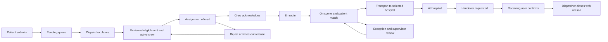

# WS4 response workflow: implementation and demo handoff

8 October 2026. Read this before older planning notes. This is implemented source
and local verification, **not a claim that a hosted backend or the full demo has
passed acceptance**. The app remains stopped. No shared database was changed.

## What changed

Before this work, dispatch could accept a patient request, record notes and
priority, send patient messages and close the incident. Fleet and crew sections
were previews. There was no exclusive ambulance reservation or crew-to-hospital
workflow behind them.

The real app now has an authenticated response workspace. Dispatch selects an
eligible unit, its actual linked crew acknowledges it, and that crew records
arrival, transport and handover. A separate receiving user confirms receipt.
Assignment and audit records are saved in PostgreSQL, not simulated in Flutter.
Use fictional people, vehicles and hospitals for the demo. No ER24 API or ER24
acceptance is implied. The existing optional external-provider simulator remains
separate; an accepted or uncertain provider request cannot also reserve a Corvia
unit. The phone fallback remains available and never places a call automatically.

Remote refs were fetched successfully on 8 October. Testing remains `bf86213`
and Eugene remains `2951288`. No additional Fleet/Paramedic producer was found in
the available branch trees. No branch switch or merge was needed. Teammates may
still have unpublished work; compare their actual commits when available.

## How the workflow works

The established incident status contract stays `pending`, `in_progress`,
`resolved`, `cancelled`. Acceptance is recorded on the incident. Detailed response
milestones belong to the assignment: `offered`, `acknowledged`, `en_route`,
`on_scene`, `transporting`, `at_hospital`, `handover_requested`, `completed`.
`rejected`, `timed_out` and `withdrawn` release that assignment. This avoids
breaking older screens by adding unexpected incident status values.

| Person | Allowed work and safeguards |
| --- | --- |
| Patient | Existing deliberate intake, own saved status/history, patient messages and cancellation path. No fleet/internal-team access. |
| Incident owner | Assign an eligible unit, select destination with reason, message crew, release an expired/unacknowledged offer and close after resources are released. |
| Same-organisation supervisor | Review exceptions, withdraw after acknowledgement with reason, reassign and review failed handover/reroute. No silent override of unsafe unit eligibility. |
| Independently authorised fleet reviewer | Record inspection, equipment, oxygen, fuel, communications, cleaning, documents, faults and capability checks with reason. Cannot review their own active crew's unit. A failed check makes the unit unavailable. |
| Verified current crew | Receive only an assigned incident, acknowledge/reject, share a device location explicitly, send updates/messages, record patient match evidence and request handover. |
| Mapped receiving staff | Read the response for their selected hospital, exchange response messages and independently confirm the requested handover. |

Profile role strings are navigation hints. Server-managed memberships, the
snapshotted assignment roster, shift/verification times and active profiles
determine actual access. A changed roster cannot silently inherit a live case.
An active assignment must be released before changing its roster. Deactivating a
profile denies that person's access immediately on the server.

Only one active assignment can reserve a unit or crew. There is one primary and
one requested backup slot per incident. Competing commands use incident/unit
versions, row locks and unique constraints. Each action has a stable operation ID;
an exact retry returns its receipt instead of repeating the action. A failure to
write the audit record rolls back the state change.

## Minimum WS5 and WS6 support implemented here

The dependency layer contains durable unit and crew IDs, organisation ownership,
time-bounded crew/member verification and shifts, independent readiness reviews,
freshness-aware positions, reservation/release, crew acknowledgement and progress,
patient-match evidence, exceptions, team messages and independent hospital receipt.
It is enough to exercise the WS4 journey without waiting for another developer's UI.

It is **not the whole Fleet or Paramedic product**. Fleet registration, documentary
credential verification, clinical care records, equipment inventories, maintenance
scheduling and durable encrypted offline clinical documentation remain separate
workstreams. Owner-provisioned synthetic verification is not evidence that a real
paramedic is licensed or that a real ambulance is inspected. Readiness checks are
recorded attestations, not sensor measurements or a clinical qualification system.

When the teams deliver code, map these identifiers rather than create competing
assignment writers: incident bigint; Auth/profile user UUID; organisation, unit,
crew, assignment and canonical `public.hospitals.id` UUIDs. Compare ownership,
membership, shift validity, readiness, assignment exclusivity, acknowledgement,
release and handover semantics. Keep one authoritative producer for each record.
The legacy `incident_responder_assignments` records have no reliable completion
contract, so they continue to block closure and are not silently reinterpreted.

## Location, hospitals, messages and exceptions

The page shows recorded incident/unit/hospital coordinates and opens those exact
coordinates in OpenStreetMap only when requested. It does not fabricate moving
vehicles. It displays source, capture time, accuracy and unavailable/stale state.
Device location is a deliberate single update, not continuous tracking. Missing
GPS never becomes a fabricated position. Unit positions expire after five minutes
by default; an expired position prevents a new assignment. Acknowledgement is due
within two minutes by default. These are demo settings in `response_settings`, not
legal or clinically approved service levels. Readiness reviews from the UI expire
after eight hours; the server rejects expiry beyond twelve hours.

Hospital identity, address/contact and directory update time come from existing
`public.hospitals`. An active directory row does not prove clinical capability,
bed availability or acceptance. Those are explicitly unverified, and the operator
must confirm suitability. The receiving account's later confirmation is the saved
handover receipt; the crew cannot confirm its own receipt.

Response-team messages are saved audit events with actor, occurrence time, saved
time and incident version. The UI refreshes every 15 seconds. “Saved” means server
persistence, not read/delivery acknowledgement. On failed reads, retained data is
marked outdated and actions are disabled. Unknown writes keep the exact operation
in memory for an explicit retry; refresh never resends. Closing the page loses that
in-memory retry, so check saved state before issuing a new action. There is no
silent offline queue. Account changes and typed authorization denials clear data.

No patient found, unsafe scene, multiple patients, refusal, unit failure, backup
and failed handover are recorded exceptions with a reason. They stop ordinary
progress until reviewed. They do not invent patient identities, clinical consent,
new patient records or a refusal decision. A unit failure requires release and
reassessment. A failed handover requires supervisor review before rerouting.
After a completed/acknowledged withdrawn response, the unit requires a fresh
readiness review. Dispatch closes only after all response resources are released.

## Exact implementation files

All paths below are relative to the Corvia repository root.

| File | Purpose |
| --- | --- |
| `supabase/scripts/ws4_dev/005_response_workflow.sql` | Additive tables, authoritative RPCs, access checks, state transitions, readiness, private audit and closure/provider/roster guards. |
| `lib/services/response_workflow_service.dart` | Authenticated response RPC adapter, response validation, typed denial handling and receipt validation. |
| `lib/pages/dispatch/response_workspace_page.dart` | Connected dispatch/crew/receiver screens, readiness review, timeline, maps, messages, exceptions and exact retry controls. |
| `lib/pages/dispatch/dispatch_dashboard.dart` | Routes active incidents, Fleet, map, hospitals and completed cases to saved response data. |
| `lib/widgets/incident_workspace_panel.dart` | Opens the connected response for the selected dispatch incident. |
| `lib/pages/shared/settings.dart` | Entry for authorised crew/receiving staff without rewriting their existing account origin or hospital role. |
| `test/response_workflow_test.dart` | Model/service/widget regressions, typed denial, retry, mobile crew, patient-match and readiness controls. |
| `test/emergency_dispatch_dashboard_test.dart` | Updates the old preview wording assertion. |
| `test/backend/ws4/run_response_workflow_tests.py` | Disposable PostgreSQL lifecycle, access, concurrency, recovery, readiness and provisioning checks. |
| `test/backend/ws4/run_shared_upgrade_tests.py` | Runs response contracts against the supplied legacy catalog fixture and checks preserved clinical profiles. |
| `tools/build_ws4_shared_upgrade.py` | Includes the tested response delta in the guarded shared upgrade. |
| `supabase/scripts/ws4_release/001_shared_upgrade.sql` | Generated existing-schema upgrade candidate; not applied to a hosted project. |
| `tools/build_ws4_response_demo.py` | Generates synthetic-only setup SQL from explicit existing account/organisation/hospital UUIDs. Does not execute SQL or create accounts. |
| `supabase/scripts/ws4_dev/README.md`, `supabase/scripts/ws4_release/README.md`, this document | Current rollout and demonstration instructions. |

## Backend preparation for a real demo

1. Select an approved synthetic test project. Confirm the actual installed schema
   and a backup/restore route. Do not infer deployment from a Git branch.
2. For the already owned synthetic core, apply only missing additive migrations
   002, 003, 004 and 005 in order. Never replay 001 on existing data. For an
   unextended shared Corvia schema, use the preflight/review process in README
   and the generated shared upgrade instead. An already partially extended shared
   schema needs a reviewed migration diff, not blind reapplication.
3. Use six distinct synthetic Auth users with matching active profile rows:
   patient, dispatcher, supervisor/independent fleet reviewer, crew A, crew B,
   receiving user. Add a second dispatcher and unrelated organisation for negative
   tests. Do not put credentials in Git, Flutter source or Obsidian.
4. Use an existing synthetic organisation and canonical synthetic hospital with
   real UUIDs. `build_ws4_response_demo.py --help` lists all required UUID arguments.
   Generate to an explicit new output file, inspect it, then have the owner apply
   it only on the synthetic project. It refuses shared installation markers,
   conflicting assignments and repeat provisioning. It never marks units ready.
5. The reviewer records readiness in the actual screen. Demo crew/member/shift
   verification expires after eight hours; an owner must review and renew an idle
   roster for a later rehearsal. Unit coordinates are labelled operator-entered
   synthetic positions and become stale; refresh deliberately before allocation.
6. Build with the intended public project configuration and
   `CORVIA_EMERGENCY_DISPATCH_ENABLED=true`. Keep provider demo disabled for the
   internal response journey. Never use an owner/service secret in the client.
7. Run the following manual matrix with normal signed-in sessions. Local SQL tests
   emulate Auth claims; they do not prove Supabase Auth/PostgREST/RLS deployment.

## Demo and manual acceptance checklist

Use separate browser profiles/devices, never multiple roles sharing one session.
Record actual results, project/build identity, time and evidence. Do not tick a
step based only on source review or an AI explanation.

| Check | Expected result |
| --- | --- |
| Patient submits with and without GPS | Exactly one saved request; clear unknown/location state; dispatcher sees the same ID and scene details. |
| Two dispatchers claim together | Exactly one owner and claim event; losing session refreshes safely. |
| Independent reviewer fails oxygen/fault check | Unit is unavailable. Reviewer, reason, checks and expiry are saved. Own-crew review and unauthorised review are denied. |
| Reviewer approves complete synthetic checks | Only verified, on-shift, crewed, fresh-position unit becomes assignable. Missing/expired review, crew verification or position prevents assignment. |
| Two incidents compete for one unit | Exactly one active reservation; no duplicate crew or unit assignment. |
| Crew A opens Settings → Emergency response workspace | Same incident ID, priority, patient-reported scene details and assignment. Crew B/unrelated accounts cannot act on it. |
| Offer rejection/timeout | Reasoned rejection or visible overdue offer; dispatch explicitly releases and reassigns. Late acknowledgement fails. |
| Happy path | Acknowledge → en route → on scene → record patient match evidence → choose confirmed destination → transporting → at hospital → handover request with summary. No skipped state. |
| Dispatch/crew messages | Same saved message and actor in both sessions; failed/unknown outcomes visible; exact retry does not duplicate. |
| Receiving staff accepts | Only the selected hospital's independent receiver confirms; crew loses access when released; unit needs another readiness review. |
| Dispatcher closes | Explicit reason, terminal patient/dispatch status, completed response visible in history. Closure with active primary/backup is refused. |
| Exceptions | Exercise no patient, unsafe scene, multiple patients, refusal, failure, backup and failed handover on separate synthetic cases. Check review, reassignment/reroute, audit and release. |
| Connectivity and navigation | Drop a read and a write response. Check stale controls, unknown result, refresh-only recovery, same-operation retry and refresh after leaving/reopening. |
| Revocation/account change | Deactivate profile/membership and switch user while a read/review is open. Protected data and dialog clear; old queued callback/retry cannot restore access. |
| Maps and directory | Deny GPS, provide stale positions, deactivate destination. No false freshness, bed availability or hospital acceptance. Verify narrow phone layout and external map failure. |
| Phone fallback | Inspect the dialler handoff using a harmless test number or cancel before calling. Never ring ER24/emergency services for a demo test. |

## Verification and completion boundary

Verified on 8 October: **736 Flutter tests; 88 response SQL checks; 71 existing
operations SQL checks; 32 shared-schema rehearsal checks passed.** The enabled
release web build and changed-file analysis passed. Full-project analysis retains
12 existing findings in the unrelated hospital-transfer and doctor-dashboard code.
The build also reports existing dependency WebAssembly dry-run warnings; the
JavaScript release build succeeds. All disposable PostgreSQL servers were stopped.
The generated shared SQL matches its builder, and diff whitespace review passes.

Automated results are recorded in the 8 October Obsidian response-workflow session
note. Run Flutter tests, changed-file/full analysis, release web build, response
SQL suite, existing operations suite and shared upgrade rehearsal after changes.
Review generated SQL against its builder; review access/ordering/retry/roster and
privacy behavior separately from happy-path tests. No automatic test proves that
a real hospital will accept a patient or that a provider has received a request.

WS4's implemented demo path no longer depends on unpublished WS5/WS6 screens.
**Final demo acceptance remains the normal-auth, multi-user manual matrix above.**
Native GPS/dialler behavior and the actual target schema also require that test.
Voice, real ER24, clinical records and production rollout are outside this demo
implementation. Unavailable voice/report sections remain explicitly labelled;
the supported communication path is persisted messaging plus callback.

Security/privacy controls support restricted access, minimal operational data,
attributable changes, explicit location sharing and honest outcomes. They are not
legal certification. Before real health data or emergency operations, the operator
must approve clinical protocols, credentials, capabilities, retention, access,
hosting/transfers, incident response and provider contracts under applicable South
African requirements. Reference [POPIA](https://www.gov.za/documents/protection-personal-information-act)
and the [National Health Act](https://www.gov.za/documents/acts/national-health-act-61-2003-23-jul-2004).
Use synthetic data until those decisions and deployment tests are complete.
